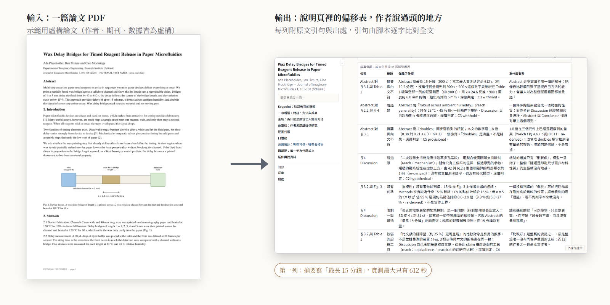
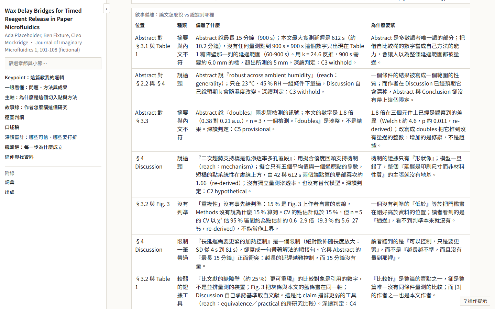
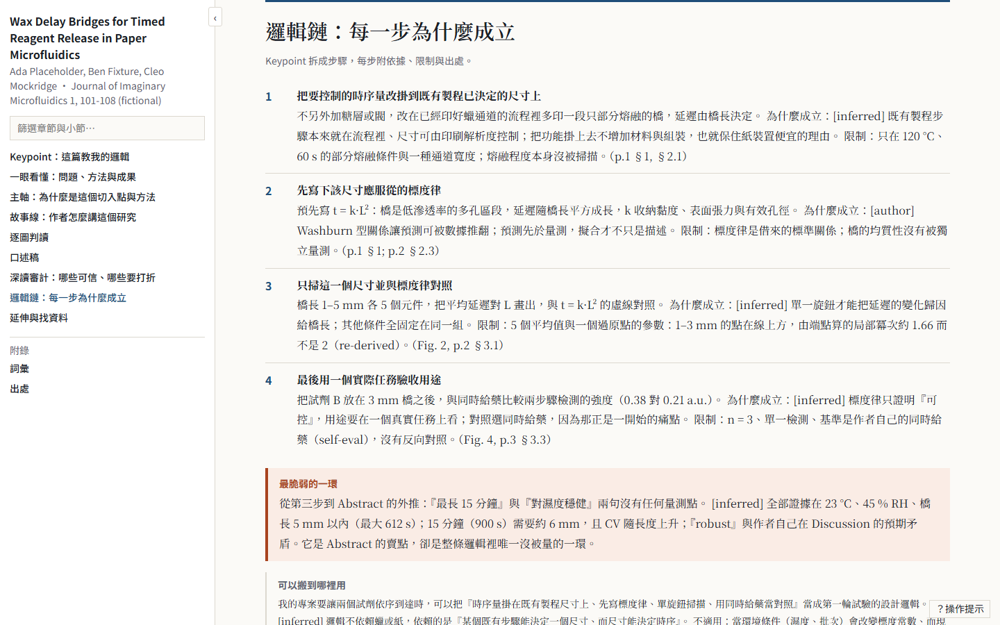
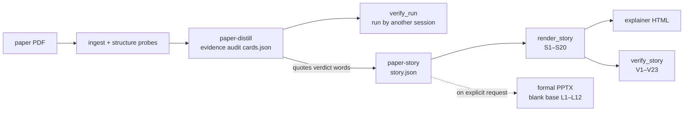

<div align="center">

# paper-survey-kit

**Have an AI agent audit a paper's evidence first, then rebuild why the authors did and told it that way, as a story you can present.**

Two Claude Code skills (paper-distill: evidence audit; paper-story: narrative reconstruction) + the shared page builder and gates they use + a fictional demo paper with a full worked run + two-sided acceptance controls.

[繁體中文](README.md) · **English**

[](https://github.com/WizerdBaChe/paper-survey-kit/releases/latest)
[](LICENSE)
[](LICENSE-DOCS)
[](AGENTS.md)
[](docs/DEVELOPER.md)
[](docs/DEVELOPER.md)

[Examples](#at-a-glance) · [Quick start](#quick-start-hand-it-to-your-agent) · [How it works](#how-it-works) · [Developer docs](docs/DEVELOPER.md) · [Agent entry](AGENTS.md) · [Changelog](CHANGELOG.md)



<sub>Generated by <code>docs/assets/build_assets.py</code> from the shipped demo run. The demo paper is fictional (authors, journal and data are invented). Labels in the picture are in Traditional Chinese.</sub>

</div>

## The problem

Ask an AI to read a paper and you often get **a fluent summary that repeats where the authors overreached**, or a list of highlights that **cannot say why the experiment was designed that way**, which falls apart at the first question in a talk.

This repo reads one paper two ways and keeps both in one run folder:

| | you get | how it holds |
|---|---|---|
| **① Evidence audit** (paper-distill) | IMRaD skeleton, claim audit, figure cards, writing craft, a learning record | read backwards (conclusion → abstract → figures → intro → methods); an origin tag on every sentence `[author]` `[verified]` `[inferred]` `[assumed]`; what a figure shows is read from the figure, not its caption; verdict words limited to provisional / leaning / hypothetical / withhold |
| **② Narrative reconstruction** (paper-story) | axis, storyline, drift table, key point, a practice explainer page, an optional formal English deck | every step needs a why (empty or restated → blocked); every drift row carries a verbatim quote that a script finds in the full text; the key point is logic you can carry to another paper, not a summary |

## At a glance

| | |
|---|---|
|  |  |
| **Drift table** — where the telling outruns the evidence | **Key point** — a slogan with no material names or numbers, plus bindings and warrants |


<sub>Pipeline labels are in Traditional Chinese.</sub>

## Quick start (hand it to your agent)

Paste this to Claude Code (or any agent that can read files and run Python):

```text
Read AGENTS.md in https://github.com/WizerdBaChe/paper-survey-kit and follow it:
1. run verify/run_controls.py and compare the result with verify/controls_run.txt;
2. list which paths in BUILD-SPEC §8 map to what in my environment and wait for my confirmation;
3. then install the two skills and the tools they need into my ~/.claude.
Do not change any gate's verdicts; report any mismatch to me.
```

## How it works



## What's new (v1.0.0)

- Both skills public in full: scripts, schemas, method docs, de-identified byte copies.
- The formal deck is built on a **template-free blank base** (4:3); no group's template ships; your own can be dropped in.
- A fictional demo paper with four deliberate evidence gaps, and a full run on it.
- Acceptance controls K1–K8, each printing the correct and the deliberately broken value.

## You want… read…

| you want | read |
|---|---|
| a finished run | [`examples/library/Placeholder2026_wax-delay-bridges/`](examples/library/Placeholder2026_wax-delay-bridges/) |
| which rules code enforces and which rely on a reader | [`docs/EVIDENCE.md`](docs/EVIDENCE.md), Enforcement map |
| to adapt it | [`docs/DEVELOPER.md`](docs/DEVELOPER.md) (Traditional Chinese), [`docs/BUILD-SPEC.md`](docs/BUILD-SPEC.md) |
| an agent install | [`AGENTS.md`](AGENTS.md) |
| a read-only agent route | [`llms.txt`](llms.txt), Read-only route |

## Limits

- Scripts check presence, emptiness and verbatim quotes; **whether a why is right, a verdict earned or a key point transferable stays a reader's call**. See the Enforcement map in [`docs/EVIDENCE.md`](docs/EVIDENCE.md).
- The explainer page is Traditional Chinese; the formal deck is English.
- Tested only on Windows 11 + Python 3.12; PowerPoint layout measurement (`--render`) needs Windows + PowerPoint.
- PyMuPDF is AGPL-3.0 (or commercial).
- Full limits and the manual acceptance list: [`docs/DEVELOPER.md`](docs/DEVELOPER.md).

## Author

BaChe · [GitHub](https://github.com/WizerdBaChe) · [Website](https://wizerdbache.com/) · [YouTube](https://www.youtube.com/@wizerdbache) · [Threads](https://www.threads.com/@wizerd.bache)

## Licence

Code [MIT](LICENSE); documentation, demo paper and images [CC BY 4.0](LICENSE-DOCS); third-party material in [`THIRD_PARTY_NOTICES.md`](THIRD_PARTY_NOTICES.md).
