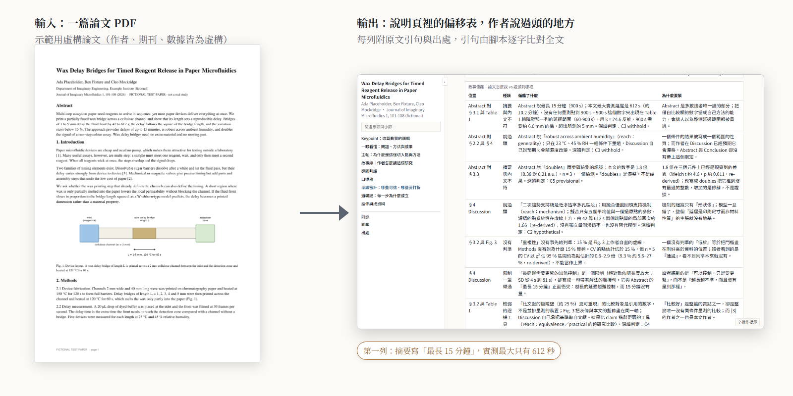
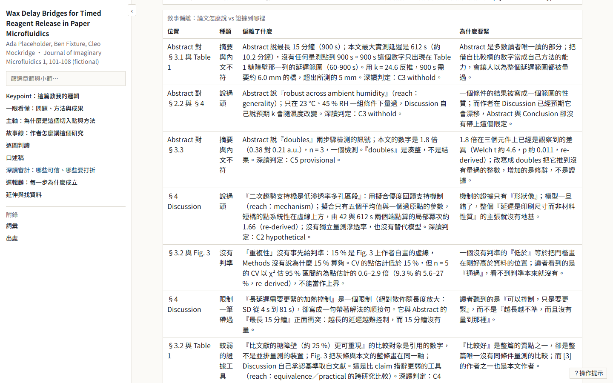
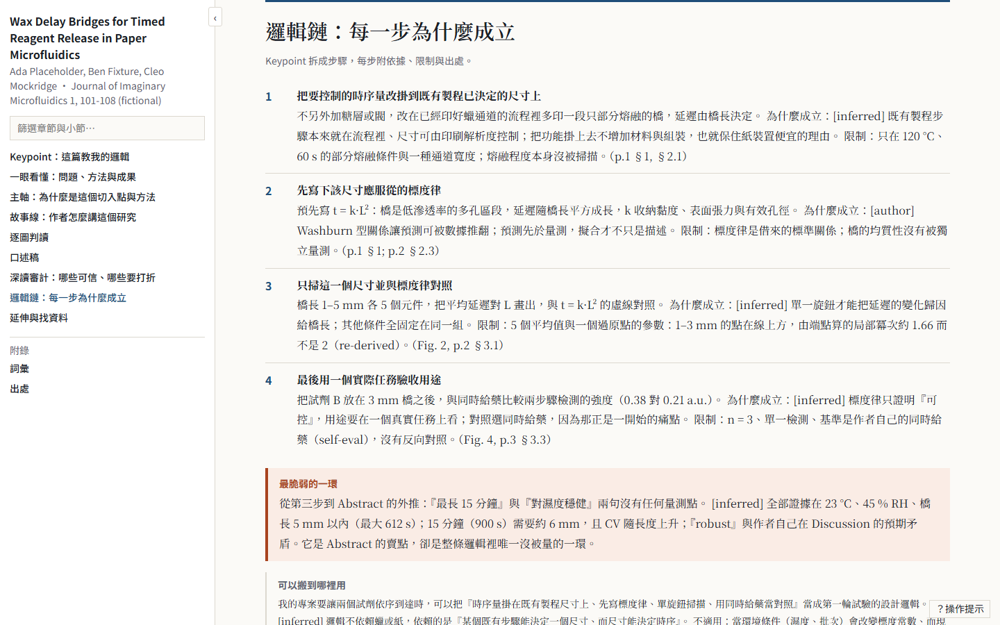
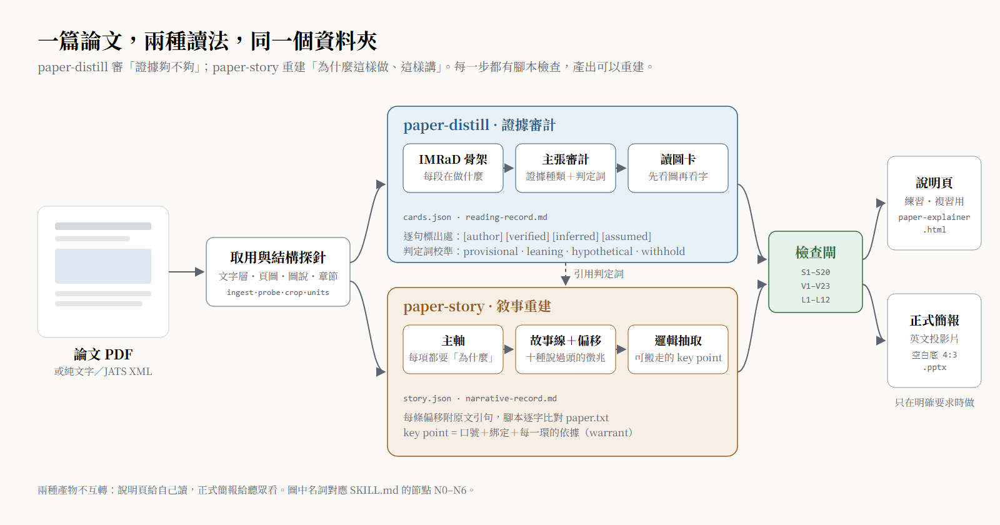
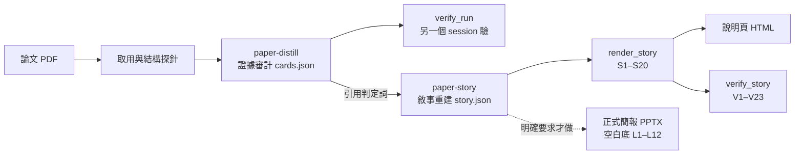

<div align="center">

# paper-survey-kit

**讓 AI agent 讀一篇論文時，先查證據撐不撐得住，再把作者「為什麼這樣做、這樣講」重建成可以報告的故事。**

兩個 Claude Code skill（paper-distill 證據審計、paper-story 敘事重建）＋ 共用的頁面產生器與檢查工具 ＋ 一篇虛構示範論文與完整跑完的成果 ＋ 雙側驗收腳本。

**繁體中文** · [English](README.en.md)

[](https://github.com/WizerdBaChe/paper-survey-kit/releases/latest)
[](LICENSE)
[](LICENSE-DOCS)
[](AGENTS.md)
[](docs/DEVELOPER.md#環境)
[](docs/DEVELOPER.md#環境)

[看範例](#一眼看懂) · [快速開始](#快速開始交給你的-agent) · [運作流程](#運作流程) · [開發者文件](docs/DEVELOPER.md) · [給 agent 的入口](AGENTS.md) · [版本紀錄](CHANGELOG.md)



<sub>上圖由 <code>docs/assets/build_assets.py</code> 從示範成果直接截圖產生。示範論文是虛構的（作者、期刊、數據都是編的），圖內標籤為繁體中文。</sub>

</div>

## 它解決什麼

請 AI 幫你讀論文，常見的結果是：**摘要寫得很順，但把作者說過頭的地方也一起照抄**；或者整理出一堆重點，**卻說不出這篇為什麼要這樣設計實驗**，上台報告時被一問就倒。

這個 repo 用兩種讀法讀同一篇論文，結果放在同一個資料夾：

| | 你得到的 | 怎麼守住 |
|---|---|---|
| **① 證據審計**（paper-distill） | IMRaD 骨架、主張審計、讀圖卡、寫作手法、學習紀錄 | 倒著讀（結論→摘要→圖→前言→方法）；每句標出處 `[author]` `[verified]` `[inferred]` `[assumed]`；圖的內容從圖本身讀，不從圖說抄；判定詞只能用 provisional / leaning / hypothetical / withhold |
| **② 敘事重建**（paper-story） | 主軸、故事線、偏移表、key point、練習用說明頁、（選用）英文正式簡報 | 每一步都要寫「為什麼」，空的或重複 what 就擋下；每條偏移附原文引句，腳本逐字比對全文；key point 是能搬到別篇的邏輯，不是摘要 |

## 一眼看懂

<table>
<tr>
<td width="50%" valign="top">

**偏移表：作者說過頭的地方**<br>
<sub>每列一種徵兆、一句原文引句、一個出處；引句由腳本逐字比對論文全文</sub>



</td>
<td width="50%" valign="top">

**key point：可以搬走的邏輯**<br>
<sub>一句不含材料名、不含數字的口號，加上每個角色在這篇的對應與每一環的依據</sub>



</td>
</tr>
<tr>
<td colspan="2" valign="top">

**整體流程：一篇論文，兩種讀法，同一個資料夾**<br>
<sub>圖中名詞對應 SKILL.md 的節點 N0–N6；正式簡報只在明確要求時做</sub>



</td>
</tr>
</table>

## 快速開始（交給你的 agent）

把下面這段貼給 Claude Code（或其他能讀檔、跑 Python 的 agent）：

```text
請讀 https://github.com/WizerdBaChe/paper-survey-kit 的 AGENTS.md，照它的步驟：
1. 先跑 verify/run_controls.py，把結果和 verify/controls_run.txt 對照後告訴我；
2. 列出 BUILD-SPEC §8 裡哪些路徑要對應到我的環境，等我確認；
3. 確認後把兩個 skill 和它們需要的工具裝進我的 ~/.claude。
不要改任何檢查閘的判定；有不一致就回報給我。
```

裝好之後，對一篇論文說「深讀這篇」會走證據審計，說「這篇要報」會走敘事重建。

## 運作流程



## 這版有什麼（v1.0.0）

- 兩個 skill 完整公開：腳本、schema、方法文件，去識別化後的位元組副本。
- 正式簡報改成**無模板空白底**（4:3），不附任何團體模板；有自己的模板可以放進去用。
- 一篇虛構示範論文，故意埋了四個證據缺口，以及在它上面完整跑完的成果。
- 驗收腳本 K1–K8，每一項都印出「正確版 vs 故意弄壞版」兩個值。

## 你想要……就讀……

| 你想要 | 讀 |
|---|---|
| 看完整跑完長什麼樣 | [`examples/library/Placeholder2026_wax-delay-bridges/`](examples/library/Placeholder2026_wax-delay-bridges/) |
| 知道哪些規則是程式擋的、哪些靠人 | [`docs/EVIDENCE.md`](docs/EVIDENCE.md) 的 Enforcement map |
| 改造成自己的版本 | [`docs/DEVELOPER.md`](docs/DEVELOPER.md)、[`docs/BUILD-SPEC.md`](docs/BUILD-SPEC.md) |
| 讓 agent 安裝 | [`AGENTS.md`](AGENTS.md) |
| 只讀不執行的 agent 入口 | [`llms.txt`](llms.txt) 的 Read-only route |
| 方法本身 | [`paper-distill/SKILL.md`](reference-impl/skills/paper-distill/SKILL.md)、[`paper-story/SKILL.md`](reference-impl/skills/paper-story/SKILL.md) |

## 限制

- 腳本查的是「有沒有、空不空、是不是原文」；**「為什麼」寫得對不對、判定詞合不合理、key point 能不能搬走，仍要人判斷**。每條規則是程式強制或流程規則，見 [`docs/EVIDENCE.md`](docs/EVIDENCE.md) 的 Enforcement map。
- 說明頁是繁體中文，正式簡報是英文。
- 只在 Windows 11 + Python 3.12 實測；PowerPoint 版面量測（`--render`）需要 Windows + PowerPoint。
- PyMuPDF 是 AGPL-3.0（或商業授權）。
- 更多限制與人工驗收清單：[`docs/DEVELOPER.md`](docs/DEVELOPER.md#限制)。

## 作者

巴哲 BaChe · [GitHub](https://github.com/WizerdBaChe) · [網站](https://wizerdbache.com/) · [YouTube](https://www.youtube.com/@wizerdbache) · [Threads](https://www.threads.com/@wizerd.bache)

## 授權

程式碼 [MIT](LICENSE)；文件、示範論文與圖片 [CC BY 4.0](LICENSE-DOCS)；第三方材料見 [`THIRD_PARTY_NOTICES.md`](THIRD_PARTY_NOTICES.md)。
