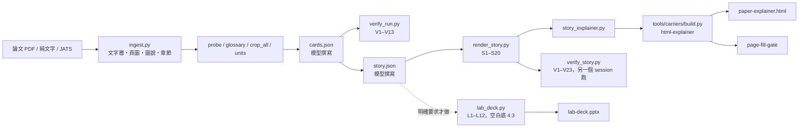
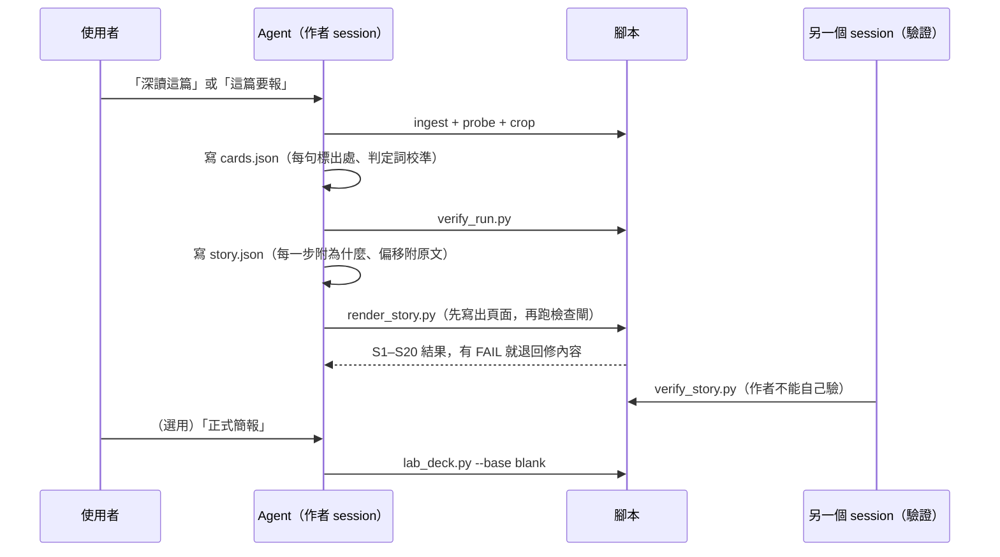

# 開發者說明（DEVELOPER）

給要安裝、改造或重建這套工具的人。要給 agent 執行的契約在 [`docs/BUILD-SPEC.md`](BUILD-SPEC.md)（英文），
量測與「哪些規則由程式強制」在 [`docs/EVIDENCE.md`](EVIDENCE.md)。

## 結構樹

```
paper-survey-kit/
├── README.md / README.en.md       宣傳頁（中文為主、英文鏡像）
├── AGENTS.md / llms.txt           給 agent：事實區在前，安裝步驟在後；llms.txt 是機器索引
├── docs/
│   ├── BUILD-SPEC.md              契約（英文）：讀法、故事、資料夾、檢查閘、驗收 K1–K8、環境調整、宣告修改
│   ├── EVIDENCE.md                實測數字、規則來源、強制對照表（Enforcement map）、不宣稱的事
│   ├── DEVELOPER.md               本檔
│   └── assets/                    README 圖片 + build_assets.py（重產所有圖）+ src/（圖的原始頁）
├── reference-impl/                原始碼的位元組副本（佈局同 ~/.claude，相對路徑可解析）
│   ├── skills/paper-distill/      證據審計：ingest、probe、glossary、crop、units、verify_run、library
│   ├── skills/paper-story/        敘事重建：render_story（S1–S20）、story_explainer、verify_story（V1–V23）、lab_deck（L1–L12）
│   ├── tools/carriers/            內容檔 → 蓋章的 HTML / PPTX（html-explainer、pptx-explainer）
│   ├── tools/page-fill-gate/      量頁面填滿度
│   └── hooks/_lib/                roots.py / tree.py / hosts.py：機器根目錄
├── examples/
│   ├── fictional-paper/           make_paper.py → 虛構論文 paper.pdf（含刻意的證據缺口）
│   └── library/Placeholder2026_wax-delay-bridges/   在虛構論文上完整跑一次的成果
└── verify/                        run_controls.py（雙側驗收）、host.toml、紀錄檔、未出貨路徑清單
```

## 元件圖



## 工作流程圖



## 模組對照

| 你想改的事 | 改這裡 |
|---|---|
| 讀論文的方法（倒著讀、出處標籤、判定詞） | `reference-impl/skills/paper-distill/SKILL.md` 與 `references/` |
| 主軸、故事線、偏移的十種徵兆、key point | `reference-impl/skills/paper-story/SKILL.md` 與 `references/` |
| 說明頁的版面 | `reference-impl/tools/carriers/html-explainer/`（改載體，所有產出一起變；不要手改 HTML） |
| 正式簡報的版面規則 | `reference-impl/skills/paper-story/scripts/lab_deck.py`、`references/formal-deck.md` |
| 換成自己實驗室的投影片模板 | 放兩份只有標題頁的 deck 到 `<PAPER_HOME>/_templates/`，改用 `--base template` |
| 資料夾放哪裡 | 環境變數 `PAPER_DISTILL_HOME`；機器根目錄看 `verify/host.toml` |

## 環境

- Windows 11、Python 3.12.7（實測環境）。其他 OS 未實測。
- 套件：`pymupdf python-pptx pillow lxml jsonschema playwright matplotlib pytest`，再跑 `python -m playwright install chromium`。
- `HK_HOST_TOML` 指向 `verify/host.toml`（或複製到 `~/.claude/adapt/host.toml`）；`PAPER_DISTILL_HOME` 指向論文庫。
- `lab_deck.py --render`（用 PowerPoint 量版面，L10）需要 Windows + PowerPoint；不加 `--render` 也能產簡報。

## 怎麼驗證

```powershell
python -X utf8 verify/run_controls.py <一個新的空資料夾>
```

每一行都印出兩個值（正確版 vs 故意弄壞的版本），結尾必須是 `-> ok`。這次發版的實際輸出在
[`verify/controls_run.txt`](../verify/controls_run.txt)，從乾淨 clone 跑的紀錄在 `verify/fresh_clone_run.txt`。

## 刻意的設計

- **兩種產物不互轉。** 說明頁（class A）是給自己練習、複習用，正式簡報（class B）是給聽眾的英文投影片；
  兩者各自從 `story.json` 產生，不會把一個轉成另一個。
- **作者不驗自己。** `verify_run.py`、`verify_story.py` 設計成由另一個 session 跑。
- **檢查閘只判它判得了的事。** 判不了的（例如文字層缺字）降為 WARN 並寫出原因，不擋下來。
  所以「引句在文字層找不到」在 verify_run 是 WARN，在 render_story 的 S10（偏移引句）是 FAIL。
- **每個檢查閘都雙側校準。** 有一個必須通過的正確輸入、一個必須失敗的壞輸入（selftest）。
- **正式簡報預設空白底。** 不附任何團體的模板；有模板的人自己放進 `_templates/`。
- **示範論文是虛構的。** 避免重製有版權的論文；它故意埋了四個證據缺口，讓審計有東西可抓。

## 限制

- 「為什麼」寫得對不對、判定詞給得合不合理、key point 能不能搬到別篇，都是人判斷，腳本只查「有沒有、是不是空的、是不是在重複 what」。
  每條規則是程式強制還是流程規則，看 [`docs/EVIDENCE.md`](EVIDENCE.md) 的 Enforcement map。
- 說明頁與 class-A 輸出是繁體中文；投影片是英文。
- 只在 Windows 實測；字型不同時頁面量測數字可能略有差異。
- PyMuPDF 是 AGPL-3.0（或商業授權），散布你做的東西前要確認授權相容。
- 文件裡的 `<PAPER_HOME>`、`<NOTES_VAULT>`、AssetVault、Retort & Rove 是原作者環境的名稱，只說明規則從哪來，不是依賴。

## 人工驗收

### A 必驗

1. 打開 `examples/library/Placeholder2026_wax-delay-bridges/paper-explainer.html`：首屏看得出這篇論文在做什麼、key point 是什麼。
2. 說明頁的偏移表：每一列都有原文引句，且「摘要寫最長 15 分鐘、內文最大 612 秒」這個缺口有被列出。
3. 用 PowerPoint 打開 `lab-deck.pptx`：白底、沒有任何團體標誌或人名，標題不換行、沒有文字超出框。
4. 在乾淨 clone 跑 `verify/run_controls.py`，每行都是 `-> ok`。
5. 照 AGENTS.md 的安裝表裝到另一台機器的 `~/.claude`，對一篇自己的論文說「深讀這篇」，確認 skill 會被叫起來。

### B 體驗

1. 說明頁在手機寬度下仍是單欄可讀。
2. 滑過術語時有說明卡。
3. 正式簡報的講稿（備忘稿）讀起來像在講話，不像在念摘要。

## 重產 README 圖片

```powershell
python -X utf8 docs/assets/build_assets.py
```

它從 `docs/assets/src/*.html` 與示範成果的 `paper-explainer.html`、`source/pages/p001.png` 截圖，
產生 `docs/assets/` 裡所有 PNG。圖內標籤是繁體中文（社群卡為英文）。不要手改圖片。

流程圖（`src/pipeline.html`）的線條由具名錨點算出、只走水平與垂直，箭頭尖端落在框邊。頁面自己量每條線
（`window.__edgeCheck`）；腳本截圖前先載入故意縮短一條線的壞樣本（`#control-short`，必須報錯），
再載入正式圖（必須 0 個問題），任一邊不對就停止、不出圖。
